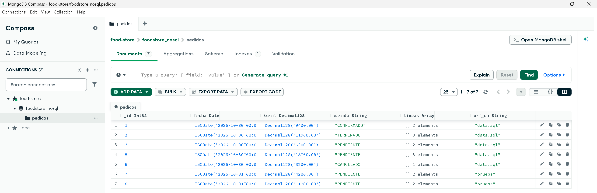
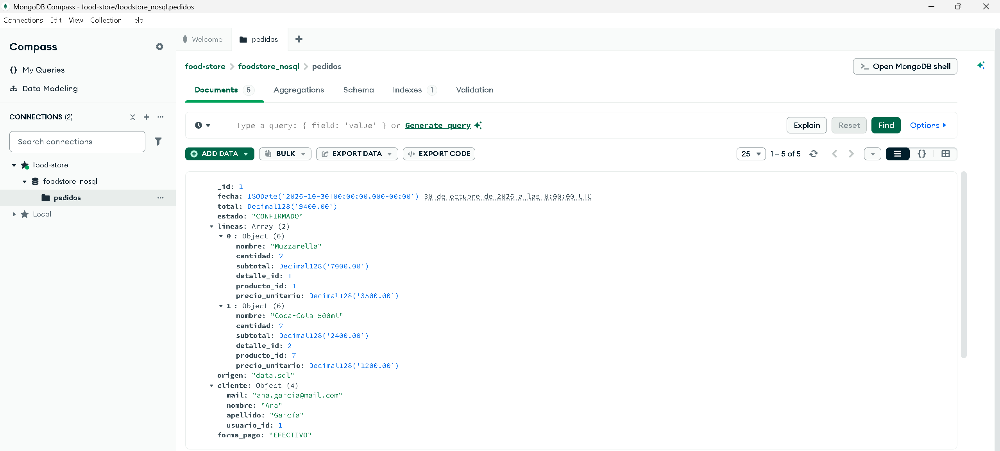
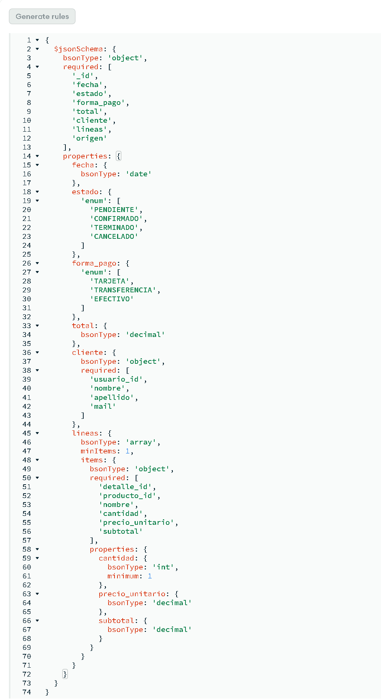

# Food Store: pedidos en MongoDB y comparación con PostgreSQL

Tecnicatura Universitaria en Programación · Bases de Datos II · Trabajo práctico de la Unidad 7 (NoSQL)

**Integrantes:** Mariano Chirino, Andrés Fabre, Facundo Quiroga
**Repositorio:** https://github.com/marianoemir/TP-Unidad7-BD2

## 1. Modelo documental

Se migró el subconjunto **pedidos y detalle de pedidos** a una única colección, `pedidos`, en la base `foodstore_nosql`. Cada documento es un pedido completo, con el cliente y las líneas embebidos. Las tablas de origen en PostgreSQL y sus claves son:

| Tabla | Clave primaria | Claves foráneas | Qué se toma |
|---|---|---|---|
| `pedido` | `id` | `usuario_id → usuario.id` | fecha, estado, total, forma_pago |
| `detalle_pedido` | `id` | `pedido_id → pedido.id`; `producto_id → producto.id`; `UNIQUE (pedido_id, producto_id)` | cantidad, precio_unitario, subtotal |
| `usuario` | `id` | — | nombre, apellido, mail (copia embebida) |
| `producto` | `id` | `categoria_id → categoria.id` | nombre (copia embebida) |

Documento real del pedido 1 (`_id` = `pedido.id`; objeto embebido `cliente`; arreglo `lineas`):

```js
{ _id: 1, fecha: ISODate("2026-10-30T00:00:00Z"), estado: "CONFIRMADO", forma_pago: "EFECTIVO",
  total: Decimal128("9400.00"),
  cliente: { usuario_id: 1, nombre: "Ana", apellido: "García", mail: "ana.garcia@mail.com" },
  lineas: [
    { detalle_id: 1, producto_id: 1, nombre: "Muzzarella", cantidad: 2,
      precio_unitario: Decimal128("3500.00"), subtotal: Decimal128("7000.00") },
    { detalle_id: 2, producto_id: 7, nombre: "Coca-Cola 500ml", cantidad: 2,
      precio_unitario: Decimal128("1200.00"), subtotal: Decimal128("2400.00") } ],
  origen: "data.sql" }
```

**Identificadores conservados:** `_id` (pedido.id), `cliente.usuario_id`, `lineas[].detalle_id` y `lineas[].producto_id`. **No se migra** `contrasena`, `celular` ni `rol`, ni los registros con `eliminado = TRUE` (el pedido 4). Los datos de clientes y productos son ficticios (los de `data.sql`).

| PostgreSQL | MongoDB | Motivo |
|---|---|---|
| NUMERIC(12,2) (importes) | Decimal128 | Evita el error binario de Double en importes |
| INTEGER (cantidad) | Int32 | Respeta el tipo entero |
| DATE (fecha) | Date (medianoche UTC) | Consultable por rango; la zona horaria es una decisión de modelo |
| ENUM (estado, forma_pago); BIGINT (ids) | string; número | Conserva los valores e identificadores existentes |

## 2. Migración e integridad

El JSON se generó desde PostgreSQL con `modelo/exportar_pedidos.sql` (sin tipear datos) y se cargó con `insertMany()` desde `consultas_mongodb.js`. Pedidos migrados: **1, 2, 3, 5, 6, 7 y 8**: los cinco vigentes de `data.sql` y dos pedidos de prueba (7 y 8, con `origen: "prueba"`), creados con `sp_crear_pedido` mediante `modelo/pedidos_de_prueba.sql` para que un mismo producto aparezca en más de un pedido. Resultado real: *Insertados: 7*, *countDocuments: 7*. Los importes y estados se copiaron tal cual, sin recalcular. Las fechas de los pedidos de `data.sql` son las del día en que se ejecutó (2026-10-30); las de los pedidos de prueba, las del día en que se crearon en cada equipo (2026-10-31 en la base usada para migrar). La fecha no interviene en la comparación entre motores.

**Dos reglas de integridad que se conservaron** (en PostgreSQL las garantizan constraints y triggers; en MongoDB se verifican después de migrar y se refuerzan con un validador `$jsonSchema`):

| Regla | Cómo se verificó | Resultado |
|---|---|---|
| 1. Coherencia de importes: total = suma de subtotales, y subtotal = cantidad × precio_unitario | En MongoDB, dos agregaciones de `consultas_mongodb.js`: documentos donde la suma de subtotales difiere del total, y líneas donde el subtotal difiere de cantidad × precio_unitario. Se comprobó además sobre el JSON exportado (`evidencias/verificacion_export_json.txt`) | 0 documentos / 0 líneas |
| 2. Líneas válidas y vigentes: cantidad > 0, estado permitido y sin registros eliminados | Validador de esquema (cantidad ≥ 1, estado en el conjunto permitido) y búsqueda de cantidad ≤ 0. Los registros con `eliminado = TRUE` no llegan a MongoDB: los excluye el export (`eliminado = FALSE`) y el campo no se migra | 0 documentos |

**Qué se embebió y por qué.** Las líneas de detalle se leen siempre junto al pedido, no tienen sentido sin él y son pocas por pedido: un solo acceso y sin JOIN. El cliente y el nombre del producto evitan consultar otras colecciones para mostrar un pedido. Se guarda el *precio histórico* de cada línea, no el precio actual del producto. **Costo:** lo embebido es una copia al momento de migrar; si el cliente cambia de mail, el documento no se actualiza. No se embebió el catálogo completo ni datos sensibles.

## 3. Consultas en MongoDB

| Consulta | Instrucción | Resultado real |
|---|---|---|
| a) Todos (_id y estado) | `db.pedidos.find({}, { estado: 1 })` | 7 pedidos: 1 CONFIRMADO, 2 TERMINADO, 3 PENDIENTE, 5 PENDIENTE, 6 CANCELADO, 7 PENDIENTE, 8 PENDIENTE |
| b) Por estado | `db.pedidos.find({ estado: "PENDIENTE" })` | 4 pedidos: ids [3, 5, 7, 8] |
| c) Por producto en el arreglo | `db.pedidos.find({ "lineas.producto_id": 1 })` | 3 pedidos: ids [1, 7, 8] (producto 1 = Muzzarella) |
| c) variante con operador de arreglo | `db.pedidos.find({ lineas: { $elemMatch: { producto_id: 1, cantidad: { $gte: 2 } } } })` | 2 pedidos: ids [1, 8] |
| d) Total mayor a un umbral | `db.pedidos.find({ total: { $gt: NumberDecimal("10000.00") } })` | 3 pedidos: ids [2, 5, 8] (totales 11900.00, 18700.00 y 11700.00) |

**Umbral de d):** 10000.00. Los totales migrados son 9400, 11900, 5300, 18700, 3200, 4200 y 11700 (promedio 9200); el umbral queda por encima del promedio y separa los pedidos grandes de los chicos. La variante con `$elemMatch` (producto 1 con cantidad ≥ 2 en la misma línea) devuelve los pedidos 1 y 8, y deja afuera el 7, que lo pidió con cantidad 1.

### Salidas de ejecución (extracto)

MongoDB (`consultas_mongodb.js`, salida completa en `evidencias/mongo_migracion_y_consultas.txt`):

```
Insertados: 7
countDocuments: 7
--- Regla 1 - total distinto de la suma de subtotales (esperado: []) ---
[]
--- Regla 1b - lineas con subtotal distinto de cantidad x precio_unitario (esperado: []) ---
[]
--- Regla 2 - lineas con cantidad <= 0 (esperado: []) ---
[]
b) ids: [3,5,7,8]
c) ids: [1,7,8]
```

PostgreSQL (`consultas_postgresql.sql`; columnas realineadas, datos de `evidencias/postgres_b.txt` y `postgres_c.txt`):

```
b) estado = 'PENDIENTE'              c) producto_id = 1 (JOIN)
id  estado     fecha       total     id  estado      fecha       total
3   PENDIENTE  2026-10-30  5300.00   1   CONFIRMADO  2026-10-30  9400.00
5   PENDIENTE  2026-10-30  18700.00  7   PENDIENTE   2026-10-30  4200.00
7   PENDIENTE  2026-10-30  4200.00   8   PENDIENTE   2026-10-30  11700.00
8   PENDIENTE  2026-10-30  11700.00
```

### Capturas de Compass







*Validador `$jsonSchema` de la colección `pedidos`, en la pestaña Validation de Compass (acción Error, nivel Strict): estados y formas de pago permitidos, importes `decimal`, `cantidad` entera ≥ 1 y al menos una línea.*

## 4. Tabla de verificación PostgreSQL vs. MongoDB

| Consulta | Cantidad en PostgreSQL | Cantidad en MongoDB | ¿Coinciden los IDs? |
|---|---|---|---|
| Estado seleccionado (PENDIENTE) | 4 — ids [3, 5, 7, 8] | 4 — ids [3, 5, 7, 8] | Sí |
| Producto seleccionado (producto 1) | 3 — ids [1, 7, 8] | 3 — ids [1, 7, 8] | Sí |

Las consultas de PostgreSQL (`consultas_postgresql.sql`) se limitan a los mismos ids migrados y a registros vigentes (`eliminado = FALSE`; en c), en `pedido` y en `detalle_pedido`), por lo que el pedido 4, dado de baja, no se cuenta. Salidas en `evidencias/postgres_b.txt` y `evidencias/postgres_c.txt` (PostgreSQL 16, base `foodstore7`) y en `evidencias/mongo_migracion_y_consultas.txt`. Las mismas consultas se ejecutaron también en PostgreSQL 17, sobre la base usada para migrar (`evidencias/postgres_ejecucion_mariano.txt`): mismos ids que MongoDB y mismas fechas (2026-10-31 en los pedidos 7 y 8).

**Diferencia detectada y corregida.** En una primera comparación los motores no coincidían: PostgreSQL, con los pedidos de prueba 7 y 8, devolvía 4 pedidos PENDIENTE y 3 con el producto 1, mientras que MongoDB, migrado solo con los cinco pedidos de `data.sql`, devolvía 2 (ids [3, 5]) y 1 (id [1]). La causa era que los pedidos 7 y 8 no estaban migrados. Se agregaron al export y se migró de nuevo (7 documentos); desde entonces los resultados coinciden. No cambiaron ni el modelo ni las consultas, y no se ajustaron datos.

## 5. Contraste de afirmaciones de la IA

Se consultó a Claude (Anthropic) para comparar PostgreSQL y MongoDB en el almacenamiento y la consulta de pedidos de Food Store, indicándole el modelo relacional actual, el acceso frecuente a pedidos completos y la necesidad de conservar la coherencia de cantidades y precios. El prompt y la respuesta completa están en `evidencias/respuesta_ia.md`; el contraste detallado, en `evidencias/contraste_ia.md`. Se contrastaron dos de sus afirmaciones:

| Afirmación de la IA | ¿Se sostiene? | Contraste |
|---|---|---|
| 1. «MongoDB no soporta reglas de integridad referencial ni validación de esquemas avanzadas; la coherencia de importes y cantidades depende exclusivamente de la aplicación» | **Solo en parte** | **Cierto:** MongoDB no tiene claves foráneas. **Falso:** sí valida esquemas; la documentación oficial describe la validación con `$jsonSchema` ([Schema Validation](https://www.mongodb.com/docs/manual/core/schema-validation/)). **Laboratorio:** `consultas_mongodb.js` crea la colección con un validador (estados, tipos `Decimal128`, cantidad entera ≥ 1, al menos una línea), visible en Compass (`evidencias/capturas/compass_validation.png`), y los 7 documentos entraron sin error. **Límite:** la regla «total = suma de subtotales» no la cubre el validador; se verificó aparte con una agregación (0 documentos), mientras que en PostgreSQL la garantizan los triggers. |
| 2. «Al embeber cliente e ítems en `pedidos` se elimina por completo la sobrecarga de los JOINs y se recupera el pedido completo en una sola operación» | **En parte** | **Documentación:** el modelo embebido permite recuperar datos relacionados en una sola operación y mejora el rendimiento de lectura, pero es desnormalizado y duplica datos ([Embedding](https://www.mongodb.com/docs/manual/data-modeling/embedding/)). **Laboratorio:** la consulta c) devuelve cada pedido completo, con cliente y líneas, sin `$lookup`. **No verificado:** el rendimiento, porque con 7 documentos no se midió ningún tiempo; «por completo» no tiene respaldo. **Costo omitido:** lo embebido es una copia (si cambia el mail de un cliente, el documento no se entera). |

## 6. Conclusión

Conviene **combinar ambas tecnologías**, manteniendo PostgreSQL como sistema de registro.

**Integridad.** PostgreSQL garantiza la coherencia de importes, cantidades y stock con restricciones, claves foráneas y triggers dentro de `sp_crear_pedido`. En MongoDB el validador controla tipos, estados y cantidades, pero no hay claves foráneas y la regla «total = suma de subtotales» hubo que verificarla aparte. Por eso las altas y modificaciones de pedidos deben seguir en PostgreSQL.

**Lectura.** El pedido completo cabe en un solo documento y se recupera con una consulta, sin `$lookup`, lo que encaja con el acceso frecuente a pedidos completos. La documentación indica mejor rendimiento de lectura, pero el laboratorio, con 7 documentos, no lo midió. El costo es duplicar datos del cliente y del producto.

El precio histórico no diferencia a los motores: ambos lo conservan copiando `precio_unitario` en cada línea.

Una copia de lectura de pedidos finalizados en MongoDB es razonable si el patrón de acceso lo justifica; con esta evidencia no alcanza para migrar la operación completa.
